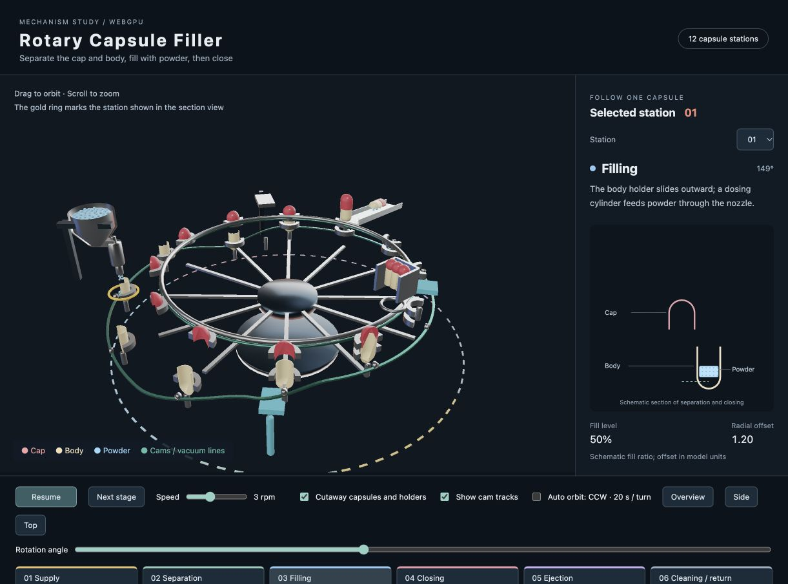

# filling_machine — Rotary Capsule Filler

English | [日本語](README.md)

## Overview

Explore capsule supply, separation, powder filling, closing, ejection and cleaning in a rotary machine. Twelve pairs of holders rotate together: upper holders retain red caps, and lower holders carry cream-colored bodies. The English interface uses the same observation controls as [the tablet press](../tablet_machine/index.en.html).

## Running and controls

Open [filling_machine.html](filling_machine.html) through an HTTP server in a WebGPU-capable browser. From the repository root, run `python3 -m http.server 8898` and open `http://localhost:8898/samples/filling_machine/filling_machine.html`.

- Drag to orbit; scroll to zoom
- **Pause / Resume** controls the mechanism; **Speed** sets 0–8 rpm, initially 3 rpm
- **Next stage** and the stage buttons position the selected station and pause
- **Station** selects the holders shown in the section view; a gold ring marks them in 3D
- **Rotation angle** sets the turntable angle and pauses
- **Cutaway capsules and holders** exposes the thin walls and powder, and hides the central shaft and lower table
- **Show cam tracks** displays the stationary guide paths
- **Auto orbit** circles counterclockwise once every 20 seconds at a fixed elevation, including while the mechanism is paused
- **Overview / Side / Top** select a fixed view and stop automatic orbiting

## Mechanism

| Stage | Motion to observe |
| --- | --- |
| Supply | An alignment guide feeds an empty capsule into the holders |
| Separation | The cap remains held while vacuum pulls the body down |
| Filling | The body holder slides outward beneath a powder-dosing nozzle |
| Closing | The body returns beneath the cap and a lower pin pushes them together |
| Ejection | The finished capsule is lifted out and guided onto the chute |
| Cleaning / return | Empty holders pass the cleaning unit and return to supply |

Green tracks show the paths guiding holder height and radial movement. Turquoise parts indicate the vacuum and cleaning units. The open hopper holds powder grains; the filling station includes a dosing cylinder, moving piston and nozzle. Powder enters a body as it passes beneath the nozzle.

Caps and bodies have open ends, round closed ends and thin walls. The 3D model and section view share their profiles. During ejection, the capsule tips onto a chute sloping outward by 10 degrees. Its position follows the capsule outline and chute slope to maintain surface contact.

## Model assumptions

This schematic model emphasizes the mechanism. Dimensions use model coordinates, and fill level is a 0–100% state. Vacuum, powder flow, shell deformation and locking grooves are represented through simplified motion. Stages progress continuously with rotation angle. An indexed machine can use separate timing for turntable motion and individual station drives.

PBR environment reflections show metal parts; capsule shells use glossy dielectric materials and powder uses a bright diffuse material.

## Code reading order

- `mechanism.js`: stage definitions, holder positions, capsule profiles and chute motion
- `main.js`: component construction, PBR rendering, animation, section view and controls
- `filling_machine.html` / `style.css`: interface and layout

## Reference

The stage sequence follows the supply, separation, filling, alignment, closing, ejection and cleaning operations in [Syntegon's capsule filling overview](https://www.syntegon.com/solutions/pharma/capsule-filling-machine/).
