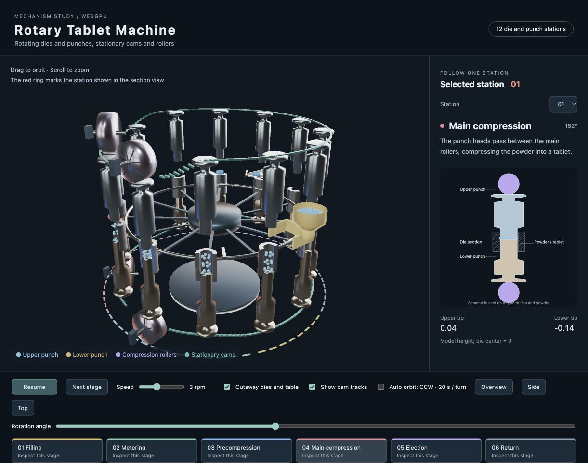

# 回転式打錠機のアニメーション

[English](README.en.md) | 日本語

[tablet_machine.html](tablet_machine.html) をHTTPサーバー経由で開きます。WebGPU対応ブラウザーを使ってください。

例：リポジトリのルートで `python3 -m http.server 8898` を実行し、
`http://localhost:8898/samples/tablet_machine/tablet_machine.html` を開きます。

操作画面と工程説明は英語で表示します。

## 観察できる機構

12組の臼・上杵・下杵が直径10.56の円周上に並び、回転盤と一緒に公転します。水平方向の基準倍率は `RADIAL_SCALE = 1.20` で、公転径、回転盤、支持リング、中央ハブを共通の倍率で配置しています。テーブル上面は臼の上端と同じ高さ0.34に揃え、臼が入る12個の開口を設けています。臼は筒状の部品で、内側の孔に粉末を保持します。上杵と下杵の先端がその孔に入り、粉末を挟みます。杵は細い先端、肩、強度を担う太い胴体、細い首、ローラーが押す杵頭をつなげた形状にしています。下杵の先端は、錠剤を押し出す高さまで臼の中を通る長さを確保しています。

上下杵の杵頭に沿う緑色の軌道は固定カムです。回転に伴って杵頭が軌道を通ることで、杵が上下に動きます。圧縮部では上下の紫色のローラーが杵頭を押し、上下の杵先端の間隔を縮めます。ローラーの回転軸は、杵の公転円周の半径方向（接線に垂直な方向）へ揃えています。ローラーの位置と軸は固定され、ローラー自体は軸の周りを回ります。予圧ローラーの直径は1.64、本圧ローラーの直径は2.00です。各ローラーの中心高さは半径と杵頭の接触面から決めています。

| 工程 | 動き |
| --- | --- |
| 充填 | 下杵を下げ、供給器の下を通る臼へ粉末を入れる |
| 計量 | 下杵を上げ、余剰の粉末をすり切り、粉末量を整える |
| 予圧 | 最初の上下ローラーで粉末を予備圧縮する |
| 本圧 | 次の上下ローラーで錠剤の厚さまで圧縮する |
| 排出 | 上杵が抜け、下杵が上昇して錠剤を押し出し、排出板で樋へ導く |
| 復帰 | 下杵を下げ、次の充填へ戻る |

## 操作

- ドラッグ：視点の回転、ホイール：ズーム
- 一時停止・再生、回転速度：初期値3 rpm（20秒で一周）。動きを観察しやすい速度に調整
- 1工程進める・工程ボタン：注目する臼をその工程へ移動して停止
- 観察する組：右側の断面図に表示する組を選択。3Dでは赤い輪で示す
- 回転位置：回転盤の位置を直接指定して停止
- 臼と回転盤を断面表示：臼の外側半分を開き、中央軸を隠して粉末と杵先端を表示
- カム軌道を表示：上下の固定軌道を表示
- 自動周回：視点が機械の周りを上から見て反時計回りに20秒で一周。俯角を固定し、鉛直軸に対するyawだけで周回する。機械の一時停止中も視点の周回を続ける
- 全体・側面・上面：カメラを所定の観察方向へ変更

## 表示の前提

機構を理解する模式モデルとして、12組の部品を間隔を広げて配置しています。透明な外装の代わりに開放した構成を採用し、初期表示では臼を縦に切った断面にしています。寸法は観察用のモデル座標です。

供給ホッパーは上面を開いた容器とし、内部に淡い青の粉末層と粒を表示しています。粉末は粒の集合、成形後は円柱状の錠剤で表します。粉末の圧縮曲線、質量、密度、圧縮力は機構の動きと別の物性計算として扱う項目です。このモデルでは工程位置から杵の高さと錠剤の状態を決めます。予圧・本圧の接触位置では円形ローラーの輪郭を使って杵頭の高さを求めます。

カムは杵頭に沿う軌道を細いレールで示します。実機のカム溝、保持部品、軸受、駆動装置は簡略化しています。供給器・排出板・樋は固定され、回転盤の孔がその下を通ります。排出樋は外側へ10度下り、錠剤の底面も同じ傾きで樋の上面に沿って移動します。

## 金属の質感

PBRとスタジオ環境光を使い、照明の明るい面が金属へ映り込む表示にしています。臼と上下杵、圧縮ローラーは金属度0.96とし、粗さは杵0.18、ローラー0.22、臼0.24で調整しています。上杵の淡い青、下杵の淡い暖色、ローラーの淡い紫は、金属を基調に部品を識別するための色です。粉末は明るい淡い青、成形後の錠剤はそれより少し濃い青で表示し、金属度0、粗さを高めにしています。弱い発光成分を加え、臼の内部でも粉末と錠剤の輪郭を見分けられる明るさにしています。

## ファイル

- `mechanism.js`：工程の角度、上下杵の高さ、圧縮ローラーの接触軌道
- `main.js`：webgの形状生成、インスタンス、アニメーション、断面図の更新
- `tablet_machine.html` / `style.css`：画面、操作部品、工程の説明

同じ部品の形状は `Shape.createInstance()` で共有し、部品位置はNodeで更新します。3Dと拡大断面は同じ `sampleCycle()` の結果を使います。

## 原理の参照

回転盤と上下杵の同期回転、カムによる軸方向の案内、充填・圧縮・排出の構成は、[Fette Compactingの公開特許 US20190039270A1](https://patents.google.com/patent/US20190039270A1/en) を参考にしています。
